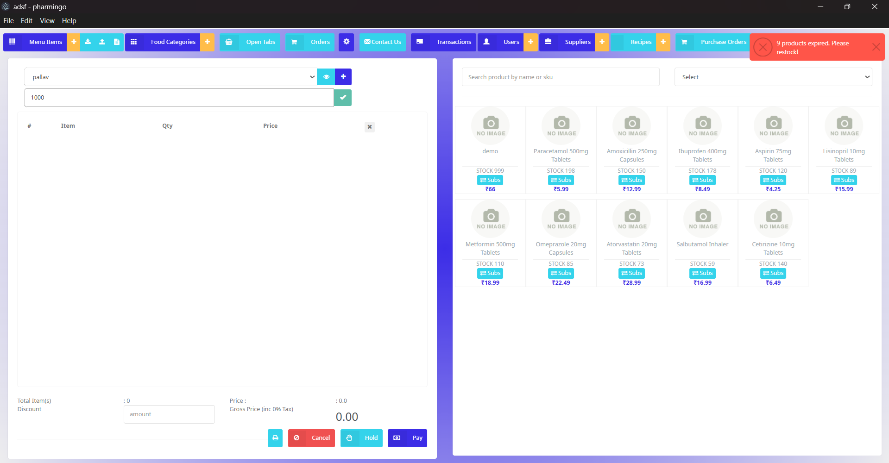
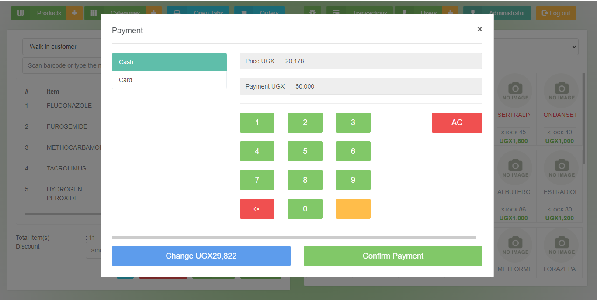
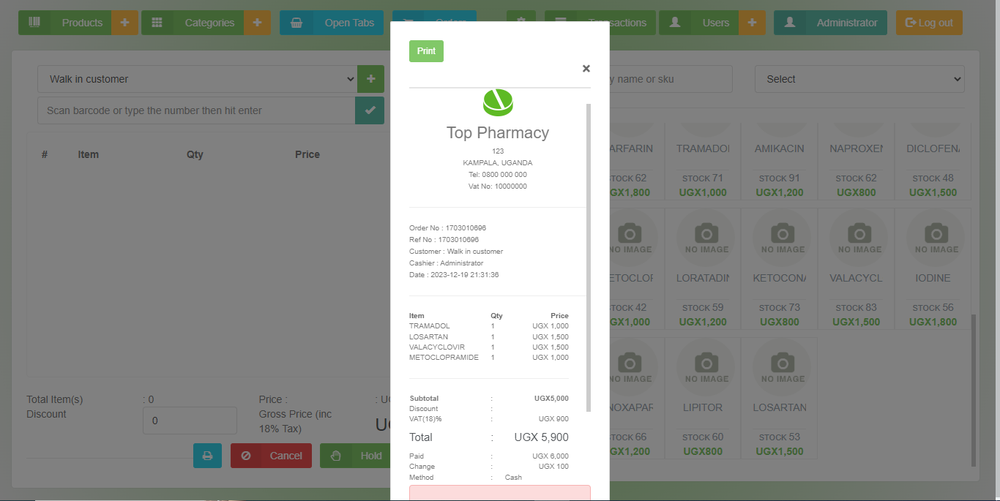

# Restaurant POS System
  [](https://github.com/akash/Pharmingo/actions/workflows/build.yml) [](https://github.com/akash/Pharmingo/actions/workflows/release.yml) [](https://github.com/akash/Pharmingo) [](https://github.com/akash/Pharmingo/blob/main/LICENSE)


Restaurant POS System is a comprehensive cross-platform Point of Sale solution designed specifically for restaurants, built to streamline operations and enhance customer service with advanced features like table management, kitchen display systems, recipe management, and analytics.

## Features

✔️ **Multi-PC Support:** Allows multiple computers on a network to access a central database, ensuring data consistency across all locations.

✔️ **Receipt Printing:** Generate professional receipts for your customers, making transactions more convenient.

✔️ **Menu Item Search:** Quickly find menu items by scanning barcodes or searching by name, simplifying order processing.

✔️ **Staff Accounts and Permissions:** Create user accounts with various permission levels to control access and actions within the system.

✔️ **Menu Management:** Easily manage your menu items and categorize them by food categories for efficient organization.

✔️ **Recipe Management:** Create detailed recipes with ingredients, costs, and scaling for portion control.

✔️ **Table Management:** Manage restaurant tables with real-time status tracking and order assignment.

✔️ **Kitchen Display System:** Real-time order management with kitchen station routing and prep time tracking.

✔️ **Combo Meal Builder:** Create and manage combo meals with advanced pricing strategies and inventory integration.

✔️ **Analytics Dashboard:** Comprehensive business intelligence with sales analytics, menu performance, and operational metrics.

✔️ **User Management:** Administer and maintain user accounts for your staff members.

✔️ **Stock Management:** Keep track of inventory and update stock levels with supplier integration.

✔️ **Open Tabs and Orders:** Manage open tables and orders to accommodate customer preferences.

✔️ **Customer Database:** Maintain a customer database to personalize interactions and build loyalty.

✔️ **Transaction History:** Access a comprehensive record of all transactions for reference and reporting.

✔️ **Transaction Filtering:** Filter transactions by till, cashier, table, or status, providing valuable insights.

✔️ **Date Range Filtering:** Narrow down transactions based on specific date ranges for in-depth analysis.

✔️ **Custom Barcode Support:** Define custom barcodes for menu items, enhancing flexibility.

✔️ **Profit Calculation:** Calculate profit per item and total profit with recipe cost integration.

✔️ **Low Stock Alerts:** Receive alerts for low stock levels to avoid running out of popular items.

✔️ **Menu Engineering:** Advanced profitability analysis and menu optimization insights.

✔️ **Real-time Updates:** Live synchronization across POS, kitchen, and table management systems.

✔️ **Modern UI:** Enjoy a fresh, modern interface optimized for restaurant operations.


## Demo

[Restaurant POS Video Preview](https://github.com/akash/Pharmingo/assets/12871099/14e32721-b5d6-4186-bb63-be59733862c3)

| **Point of Sale** |  **Kitchen Display System** |
|--|--|
|   ||
| **Table Management** |  **Analytics Dashboard** |
| | |
| **Recipe Management** | **Additional Features** |
|| <ul><li>Combo Meal Builder</li><li>Real-time Analytics</li><li>Table Layout Designer</li><li>Menu Engineering</li><li>Backup & Restore</li><li>Export to Excel/CSV</li></ul>


## Getting Started
- Download [Restaurant POS System](https://github.com/akash/Pharmingo/releases/latest)
- Unzip the package to a location of your choice.
- Click the ``RestaurantPOS`` executable in the folder
- Login for default user:

	- ``username:`` admin
	- ``password:`` admin

## Initial Restaurant Setup
After first login, configure your restaurant:

1. **Set up your restaurant profile** in Settings
2. **Create food categories** (Appetizers, Main Courses, Desserts, Beverages)
3. **Add menu items** with pricing and categories
4. **Configure tables** in Table Management (number, capacity, location)
5. **Set up kitchen stations** (Grill, Fryer, Salad, Dessert, Beverage)
6. **Create recipes** for cost tracking and inventory management
7. **Configure combo meals** for bundled pricing

## For Developers
- Clone this project.
- Open terminal and navigate into the cloned folder.
- Run ```npm install``` to install dependencies.
- Run ```npm run start```.
- Run ```gulp``` to bundle css and js assets
- Run ```npm run test``` to run tests
  
## Restaurant-Specific Documentation

- **[User Guides](docs/USER_GUIDES.md)** - Complete usage guides for all restaurant features
- **[API Documentation](docs/API_DOCUMENTATION.md)** - Technical API reference for developers
- **[Migration Guide](docs/MIGRATION_GUIDE.md)** - Converting from pharmacy to restaurant setup
- **[Technical Documentation](docs/TECHNICAL_DOCS.md)** - Development and deployment guides

## Troubleshooting

### Common Restaurant Setup Issues

**Kitchen Display Not Updating:**
- Check network connectivity between POS and kitchen stations
- Verify WebSocket connections in browser developer tools
- Ensure kitchen module is properly loaded

**Table Management Synchronization:**
- Confirm table statuses are updating across all terminals
- Check for real-time connection issues
- Verify table layout configuration

**Recipe Cost Calculations:**
- Ensure all ingredients have valid cost per unit
- Check supplier database for pricing information
- Verify recipe scaling calculations

**Combo Meal Availability:**
- Confirm all component items are in stock
- Check inventory levels for combo ingredients
- Verify pricing configuration in combo builder

For additional support, see the [Troubleshooting Guide](docs/TROUBLESHOOTING.md).

## Credits

Originally adapted from [tngoman/Store-POS](https://github.com/tngoman/Store-POS). Converted and enhanced for restaurant operations.

Feel free to report any issues or suggest enhancements via [GitHub Issues](https://github.com/akash/Pharmingo/issues).

## Contributing

Pull requests are welcome. For major changes, please open an issue first to discuss what you would like to change. Take a moment to review the [Contributing Guidelines](https://github.com/akash/Pharmingo/blob/main/CONTRIBUTING.md).

## License

Restaurant POS System is licensed under the [MIT License](https://github.com/akash/Pharmingo/blob/main/LICENSE).
